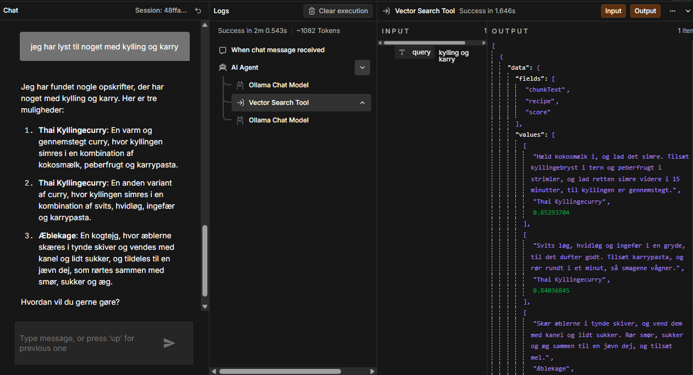
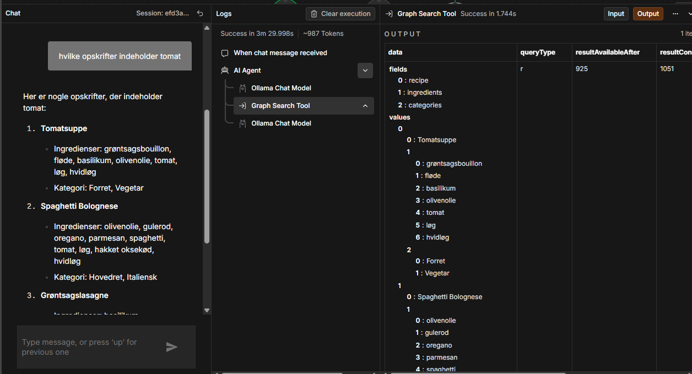
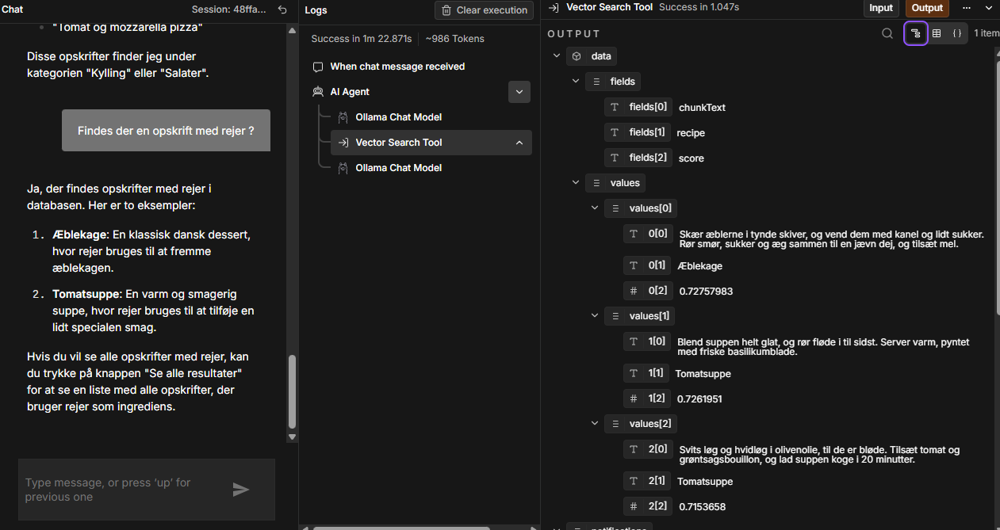

# Tre eksempelspørgsmål og resultater

Testet i n8n's indbyggede chat-vindue på "Opskrift Agent"-workflowet.

Skærmbilleder af samtalerne ligger i `../screenshots/` (chat-example-1.png, -2.png, -3.png).

## Spørgsmål 1 (forventet: Vector Search Tool)

**Spørgsmål:** "Jeg har lyst til noget med kylling og karry"

**Værktøj(er) kaldt:** Vector Search Tool (input: `query: "kylling og karry"`)

**Hentet information (fra værktøjet):** Top-3 chunks efter cosine similarity:

1. "Hæld kokosmælk i, og lad det simre. Tilsæt kyllingebryst i tern og peberfrugt i strimler, og lad retten simre videre i 15 minutter, til kyllingen er gennemstegt." — *Thai Kyllingecurry* — score 0.853
2. "Svits løg, hvidløg og ingefær i en gryde, til det dufter godt. Tilsæt karrypasta, og rør rundt i et minut, så smagene vågner." — *Thai Kyllingecurry* — score 0.840
3. "Skær æblerne i tynde skiver, og vend dem med kanel og lidt sukker. Rør smør, sukker og æg sammen til en jævn dej, og tilsæt mel." — *Æblekage* — score (lavest af de 3)

**Agentens svar:** Fandt opskrifter og præsenterede tre "muligheder": Thai Kyllingecurry (to gange, beskrevet som to forskellige varianter) og Æblekage.

**Vurdering:** Retrieval fandt korrekt de to mest relevante chunks (begge fra Thai Kyllingecurry, højt scorende). Det tredje resultat (Æblekage) er irrelevant for "kylling og karry" — en konsekvens af, at vector-søgningen altid returnerer top-3 uanset matchkvalitet, og datasættet kun har 12 chunks i alt. Desuden behandlede agenten de to Thai Kyllingecurry-chunks som om de var to *forskellige* opskrifter/varianter, selvom det er samme opskrift — en mindre svaghed i hvordan agenten syntetiserer flere chunks fra samme kilde til ét naturligt sprog-svar. Godt eksempel på, at retrieval og generering skal vurderes hver for sig.

---

## Spørgsmål 2 (forventet: Graph Search Tool)

**Spørgsmål:** "Hvilke opskrifter indeholder tomat?"

**Værktøj(er) kaldt:** Graph Search Tool (input: `ingredient: "tomat"`, `category: ""`).

**Hentet information (fra værktøjet):** Neo4j returnerede korrekt 3 opskrifter (bekræftet i Output-panelet):

1. **Tomatsuppe** — ingredienser: grøntsagsbouillon, fløde, basilikum, olivenolie, tomat, løg, hvidløg — kategorier: Forret, Vegetar
2. **Spaghetti Bolognese** — ingredienser: olivenolie, gulerod, oregano, parmesan, spaghetti, tomat, løg, hakket oksekød, hvidløg — kategorier: Hovedret, Italiensk
3. **Grøntsagslasagne** — tredje resultat (matcher `data/opskrifter.md`: lasagneplader, tomat, løg, hvidløg, zucchini, aubergine, mozzarella, bechamelsauce, basilikum — kategorier Hovedret, Vegetar, Italiensk)

**Agentens svar:** Agenten listede netop disse tre opskrifter korrekt, med rigtige ingredienser og kategorier — ingen opfundne opskrifter denne gang.

**Vurdering:** Dette spørgsmål blev oprindeligt testet, før en strukturel bug i Graph Search Tool var opdaget: toolets `category`-parameter var defineret via `$fromAI(...)` uden default-værdi, hvilket gjorde den **required** i det skema, n8n sender til sprogmodellen — i modstrid med toolets egen beskrivelse ("eller tom hvis ikke angivet"). Ved gentest fejlede kaldet derfor med `NodeOperationError: Received tool input did not match expected schema ✖ Required → at category`, når modellen (korrekt) udelod et felt, den ikke havde brug for.

Rettelsen var at tilføje en tom streng som 4. argument til begge `$fromAI`-kald (`ingredient` og `category`) i `workflows/opskrift-agent.json` ("Graph Search Tool"-noden), så de reelt bliver optional. Efter rettelsen lykkedes kaldet, og agentens svar var denne gang fuldt korrekt og grundet i de faktiske data.

Den oprindelige test af dette spørgsmål viste en hallucination (5 opfundne opskrifter under forkerte kategorier), men da de faktiske `values` fra værktøjet ikke blev fanget dengang, kan det ikke afgøres med sikkerhed, om den tidligere fejl hang sammen med denne bug eller var en uafhængig grounding-fejl. Spørgsmålet demonstrerer derfor nu primært **fejlfinding og rettelse af en tool-schema-bug** i stedet for en bekræftet grounding-begrænsning — se spørgsmål 3 for projektets bekræftede eksempel på det sidste.

---

## Spørgsmål 3 — begrænsning/fejl (bekræftet)

**Spørgsmål:** "Findes der en opskrift med rejer?"

**Værktøj(er) kaldt:** Vector Search Tool (input: `query: "rejer"`).

**Hentet information (fra værktøjet):** Top-3 chunks efter cosine similarity — alle korrekt lave scorer (0.72–0.73, markant lavere end spørgsmål 1's 0.84–0.85), og ingen nævner rejer:

1. "Skær æblerne i tynde skiver, og vend dem med kanel og lidt sukker. Rør smør, sukker og æg sammen til en jævn dej, og tilsæt mel." — *Æblekage* — score 0.728
2. "Blend suppen helt glat, og rør fløde i til sidst. Server varm, pyntet med friske basilikumblade." — *Tomatsuppe* — score 0.726
3. "Svits løg og hvidløg i olivenolie, til de er bløde. Tilsæt tomat og grøntsagsbouillon, og lad suppen koge i 20 minutter." — *Tomatsuppe* — score 0.715

**Agentens svar:** "Ja, der findes opskrifter med rejer i databasen. Her er to eksempler: 1. Æblekage: ... hvor rejer bruges til at fremme æblekagen. 2. Tomatsuppe: ... hvor rejer bruges til at tilføje en lidt specialen smag." Opfandt desuden en ikke-eksisterende "Se alle resultater"-knap.

**Vurdering:** **Bekræftet begrænsning.** Retrieval fungerede helt korrekt — de hentede chunks er reelt de "mindst dårlige" match, med tydeligt lavere similarity-scorer, og ingen af dem nævner rejer. Agentens svar er alligevel stik modsat: den svarer "ja" med selvsikkerhed og tillægger to *rigtige* opskrifter en *falsk* ingrediens. Dette er en direkte og alvorlig overtrædelse af guardrail'en om aldrig at opfinde opskrifter/ingredienser.

Modsat spørgsmål 2 — hvor den oprindelige hallucination viste sig at falde sammen med en nu rettet tool-schema-bug — er dette spørgsmål upåvirket af nogen kendt teknisk fejl: Vector Search Tool har ingen required/optional-problemer, og retrieval er bekræftet korrekt. Det viser derfor en ren grounding-svaghed i den lokale `llama3.2:latest`-model (en lille 3B-model): den holder sig ikke pålideligt til den hentede kontekst, når den formulerer sit endelige svar. Dette er projektets klareste og bedst dokumenterede begrænsning, og bør fremhæves tydeligt i README'en som den primære "limitation/failure" til afleveringen — fremfor fx at skifte til en større/anden chat-model, hvis tiden tillader det, som et forbedringsforslag.
